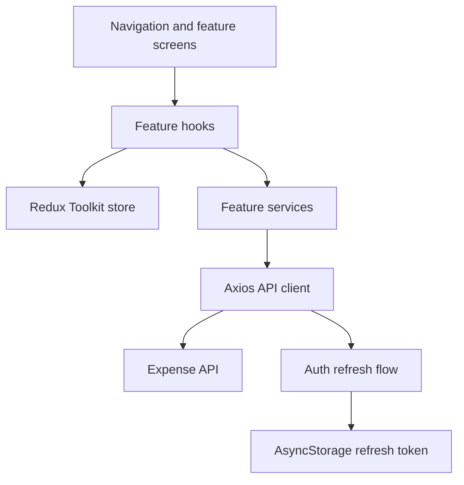

# Xpen

Xpen is a React Native expense-tracking app built with TypeScript. It supports account registration and sign-in, session restoration, and creating, editing, browsing, and deleting expenses classified as **Need**, **Want**, or **Save**.

The app is structured around feature ownership: screens and feature logic live together, while shared navigation, API access, state setup, and reusable UI components have clear application-level boundaries.

## Engineering Highlights

- **Feature-oriented modules:** authentication, categories, expenses, home, settings, and user data are separated under `src/modules`. Screens delegate business actions to feature hooks and service classes.
- **Typed application state:** Redux Toolkit owns shared authentication and category state; typed store hooks and domain interfaces keep UI, service, and API contracts aligned.
- **Centralized authenticated networking:** a shared Axios client applies the access token, enforces a request timeout, and retries expired-token responses after refreshing credentials. Concurrent failures share one refresh request.
- **Explicit session lifecycle:** the app restores a session at startup, persists the refresh token with AsyncStorage, and clears authentication and cached categories when a session ends or becomes invalid.
- **Cursor-based expense loading:** the home screen requests expenses in pages, prevents overlapping fetches, supports pull-to-refresh and load-more, and refreshes when returning to the screen.
- **Resilient category loading:** categories are cached in Redux, duplicate in-flight requests are skipped, and failed loads can be retried from the expense form.
- **Reusable UI and design tokens:** shared form, button, layout, navigation, and expense components use centralized theme values in `src/theme`.

## Architecture



The API client owns shared transport concerns; feature services translate app operations into endpoint calls; hooks coordinate UI state, validation, and side effects. The navigation tree switches between the authentication flow and the signed-in app flow based on restored Redux auth state.

### Source Layout

```text
src/
	app/          App composition and typed navigation stacks
	components/   Reusable UI building blocks
	configs/      Runtime configuration, including the API base URL
	modules/     Auth, category, expense, home, settings, and user modules
	services/     Shared API client and refresh-token storage
	store/        Redux store and typed hooks
	theme/        Colors, spacing, typography, sizes, and radii
```

## Technology

- React Native 0.85 and React 19
- TypeScript
- Redux Toolkit and React Redux
- React Navigation
- Axios
- AsyncStorage
- Jest and the React Native Jest preset

## Getting Started

### Prerequisites

- Node.js 22.11 or later
- Yarn (the repository includes `yarn.lock`) or npm
- Android Studio and an Android emulator/device for Android development
- macOS, Xcode, Ruby, and CocoaPods for iOS development

Install JavaScript dependencies:

```sh
yarn install
```

Set the backend URL in [`src/configs/env.ts`](src/configs/env.ts) before running the app if you are using a different API deployment.

### Run on Android

Start Metro in one terminal:

```sh
yarn start
```

In another terminal, build and install the app:

```sh
yarn android
```

### Run on iOS

Install CocoaPods dependencies, then launch the app:

```sh
bundle install
bundle exec pod install
yarn ios
```

## Development Commands

| Command              | Purpose                                              |
| -------------------- | ---------------------------------------------------- |
| `yarn start`         | Start Metro                                          |
| `yarn start:reset`   | Start Metro with a cleared cache                     |
| `yarn lint`          | Run ESLint                                           |
| `yarn test`          | Run Jest                                             |
| `yarn build`         | Assemble an Android debug build                      |
| `yarn build:release` | Assemble an Android release build                    |
| `yarn clean`         | Clean Android build outputs                          |
| `yarn adb:reverse`   | Forward the Metro port to a connected Android device |

The project also exposes the corresponding npm scripts (for example, `npm run lint` and `npm test`).
