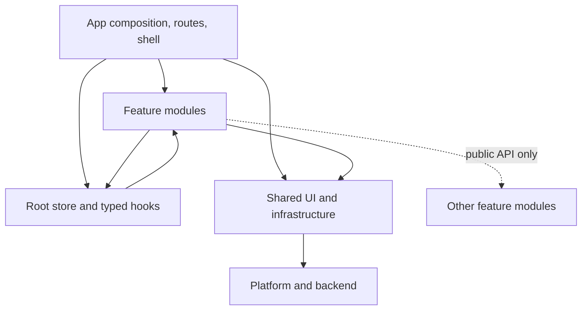
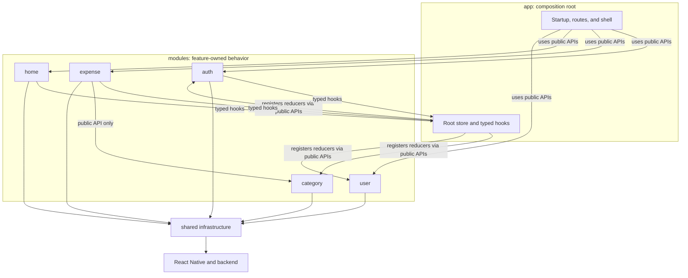

# Xpen

Xpen is a React Native expense-tracking app built with TypeScript. It supports account registration and sign-in, session restoration, and creating, editing, browsing, and deleting expenses classified as **Need**, **Want**, or **Save**.

The app is structured around feature ownership: screens and feature logic live together, while navigation, state composition, transport, configuration, and reusable UI have explicit application or shared boundaries.

## Engineering Highlights

- **Feature-oriented modules:** authentication, categories, expenses, home, settings, and user data are separated under `src/modules`. Screens delegate business actions to feature hooks and service classes.
- **Explicit state ownership:** Redux Toolkit owns auth session state, the current-user profile, and the shared category cache. Expense pages and form drafts remain local to their feature hooks because they are screen-scoped and focus-driven.
- **Centralized authenticated networking:** a shared Axios client applies the access token, enforces a request timeout, and retries expired-token responses after refreshing credentials. Concurrent failures share one refresh request.
- **Explicit session lifecycle:** the app restores a session at startup, persists the refresh token with AsyncStorage, and clears auth, user, and category state when a session ends or becomes invalid.
- **Cursor-based expense loading:** the home screen requests expenses in pages, prevents overlapping fetches, supports pull-to-refresh and load-more, and refreshes when returning to the screen.
- **Resilient category loading:** categories are cached in Redux, duplicate in-flight requests are skipped, and failed loads can be retried from the expense form.
- **Reusable UI and design tokens:** shared form, button, layout, and navigation components use centralized tokens in `src/shared/theme`.

## Architecture



### Dependency Direction



Forbidden directions: features do not import app routes or shell, features do not import another feature's internals, and `shared` does not import from `app` or `modules`.

The API client owns transport concerns; feature services translate operations into endpoint calls; feature hooks coordinate screen state, validation, and side effects. Auth owns session credentials and login state; user owns the current profile; category owns the shared category cache. Expense pagination and form drafts stay local to expense hooks because they are screen-scoped. ESLint enforces the shared and cross-feature import boundaries.

### Source Layout

```text
src/
	app/                  Composition, routes, shell, and root store
		store/              Root Redux store and typed hooks
	modules/              Auth, category, expense, home, settings, and user features
		auth/               Includes auth-specific refresh-token storage
	shared/               Reusable UI, design tokens, config, events, and API transport
```

## Technology

- React Native 0.85 and React 19
- TypeScript
- Redux Toolkit and React Redux
- React Navigation
- Axios
- AsyncStorage
- Jest and the React Native Jest preset

## Getting Started

### Prerequisites

- Node.js 22.11 or later
- Yarn (the repository includes `yarn.lock`) or npm
- Android Studio and an Android emulator/device for Android development
- macOS, Xcode, Ruby, and CocoaPods for iOS development

Install JavaScript dependencies:

```sh
yarn install
```

Set the backend URL in [`src/shared/config/env.ts`](src/shared/config/env.ts) before running the app if you are using a different API deployment.

### Run on Android

Start Metro in one terminal:

```sh
yarn start
```

In another terminal, build and install the app:

```sh
yarn android
```

### Run on iOS

Install CocoaPods dependencies, then launch the app:

```sh
bundle install
bundle exec pod install
yarn ios
```

## Development Commands

| Command              | Purpose                                              |
| -------------------- | ---------------------------------------------------- |
| `yarn start`         | Start Metro                                          |
| `yarn start:reset`   | Start Metro with a cleared cache                     |
| `yarn lint`          | Run ESLint                                           |
| `yarn test`          | Run Jest                                             |
| `yarn build`         | Assemble an Android debug build                      |
| `yarn build:release` | Assemble an Android release build                    |
| `yarn clean`         | Clean Android build outputs                          |
| `yarn adb:reverse`   | Forward the Metro port to a connected Android device |

The project also exposes the corresponding npm scripts (for example, `npm run lint` and `npm test`).
